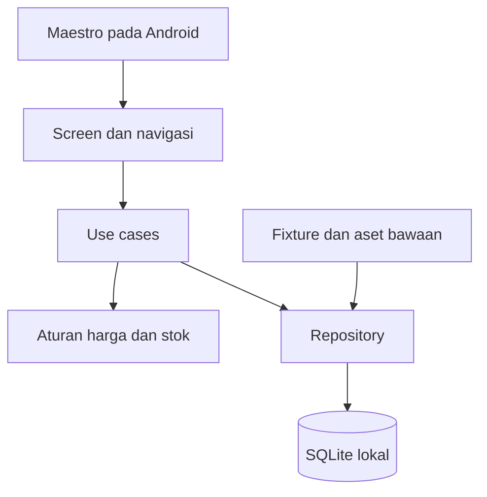

# Architecture — RavaShop

Status: rancangan. Semua komponen berikut belum dibuat.

## Batas sistem

Aplikasi Android React Native CLI menyimpan data pada SQLite lokal. UI tidak mengakses database langsung. Katalog dan gambar contoh dibundel. Tidak ada komunikasi pembayaran, bank, atau logistik.

## Modul dan tanggung jawab

- `catalog`: daftar, pencarian, filter, urutan, detail produk.
- `wishlist`: koleksi produk favorit lokal.
- `cart`: baris item dan jumlah; total dihitung dari data produk yang berlaku.
- `addresses`: CRUD alamat dan pemilihan untuk checkout.
- `checkout`: validasi ulang, snapshot, transaksi database, dan idempotensi.
- `orders`: riwayat, detail, pembatalan tepat sekali.
- `data`: schema, migrations, repository, seed; satu-satunya pemilik akses database.
- `shared`: komponen, format uang, feedback, aksesibilitas, dan testID.

## Alur checkout

UI membuat operation ID stabil untuk satu upaya konfirmasi. Use case menjalankan satu transaksi database: periksa operation ID, baca keranjang/stok, validasi alamat, tulis order dan item snapshot, kurangi stok, hapus keranjang, commit. UI menerima sukses hanya sesudah commit. Retry dengan ID yang sama mengembalikan hasil order yang sama.

Pembatalan order mengubah status confirmed ke cancelled dan mengembalikan stok dalam transaksi yang sama. Request ulang tidak mengembalikan stok lagi.

## Persistensi dan pemulihan

Seed hanya berjalan pada database baru. Membuka ulang aplikasi tidak mereset data. Migrasi memiliki versi dan dijalankan secara transaksional. Error baca atau migrasi memberi layar pemulihan; jangan menghapus data diam-diam. Reset demo adalah tindakan eksplisit dengan konfirmasi.

SQLite adalah sumber data permanen. State UI hanya menyimpan input sementara, hasil query, dan status loading. UI di-refresh setelah commit, sehingga kegagalan write tidak menghasilkan sukses palsu.

## Strategi uji

Unit menguji perhitungan dan validasi. Integration memakai SQLite sungguhan untuk rollback, constraint, migrasi, dan idempotensi. Maestro menguji aplikasi terpasang melalui UI; persistence test menutup/membuka aplikasi dengan data tetap ada. Fault injection hanya tersedia pada build E2E khusus dan tidak masuk APK distribusi.
